# ClubRelay — MongoDB Entity Relationship Diagram (ERD) & Schema Specifications

## 1. Entity Relationship Diagram

```mermaid
erDiagram
    Campus ||--o{ Club : "hosts"
    Campus ||--o{ User : "registers"
    Campus ||--o{ AcademicTerm : "schedules"
    Club ||--o{ Membership : "employs"
    User ||--o{ Membership : "holds"
    Club ||--o{ Event : "organizes"
    AcademicTerm ||--o{ Event : "occurs_during"
    Event ||--o{ EventTask : "tracks"
    User ||--o{ EventTask : "assigned_to"
    Event ||--o{ Approval : "reviewed_by"
    User ||--o{ Approval : "decided_by"
    Club ||--o{ KnowledgeItem : "preserves"
    Club ||--o{ Contact : "maintains"
    Club ||--o{ Decision : "records"
    Club ||--o{ Handover : "transitions"
    User ||--o{ Handover : "outgoing_leader"
    User ||--o{ Handover : "incoming_leader"
    Club ||--o{ AuditLog : "audits"
    User ||--o{ Notification : "receives"
    Event ||--o{ Attachment : "references"

    Campus {
        ObjectId _id PK
        string name
        string slug
        string domain
        string location
        object settings
        date createdAt
    }

    User {
        ObjectId _id PK
        ObjectId campusId FK
        string fullName
        string email
        string passwordHash
        string campusRole "CAMPUS_ADMIN | FACULTY_COORDINATOR | STUDENT"
        string avatarUrl
        string phone
        boolean isActive
        date lastLoginAt
    }

    Club {
        ObjectId _id PK
        ObjectId campusId FK
        ObjectId facultyCoordinatorId FK
        string name
        string code
        string category "TECHNICAL | CULTURAL | ACADEMIC | ENTREPRENEURSHIP | SOCIAL"
        string description
        string logoUrl
        string bannerUrl
        string status "ACTIVE | PROBATION | INACTIVE"
        date establishedDate
    }

    AcademicTerm {
        ObjectId _id PK
        ObjectId campusId FK
        string name "e.g. 2025-2026"
        date startDate
        date endDate
        boolean isCurrent
    }

    Membership {
        ObjectId _id PK
        ObjectId campusId FK
        ObjectId clubId FK
        ObjectId userId FK
        ObjectId academicTermId FK
        string clubRole "PRESIDENT | SECRETARY | CORE_TEAM | GENERAL_MEMBER"
        string title "e.g. Lead Organizer, PR Head"
        string status "ACTIVE | PAST | INVITED | REVOKED"
        date joinedAt
    }

    Event {
        ObjectId _id PK
        ObjectId campusId FK
        ObjectId clubId FK
        ObjectId academicTermId FK
        ObjectId leadOrganizerId FK
        string title
        string description
        string eventType "WORKSHOP | HACKATHON | GUEST_LECTURE | MEETUP | COMPETITION | MIXER"
        string status "DRAFT | PROPOSED | APPROVED | PLANNING | IN_PROGRESS | COMPLETED | ARCHIVED"
        date startDate
        date endDate
        string venueName
        number estimatedBudget
        number actualBudget
        number expectedAttendance
        number actualAttendance
        array tags
        object retrospective
    }

    EventTask {
        ObjectId _id PK
        ObjectId campusId FK
        ObjectId clubId FK
        ObjectId eventId FK
        ObjectId assigneeId FK
        string title
        string description
        string status "TODO | IN_PROGRESS | BLOCKED | DONE"
        string priority "LOW | MEDIUM | HIGH | URGENT"
        date dueDate
        array prerequisiteTaskIds
    }

    EventTemplate {
        ObjectId _id PK
        ObjectId campusId FK
        string name
        string eventType
        string defaultDescription
        array defaultTasks
        number estimatedLeadDays
    }

    Approval {
        ObjectId _id PK
        ObjectId campusId FK
        ObjectId clubId FK
        ObjectId eventId FK
        ObjectId reviewerId FK
        string decision "PENDING | APPROVED | MODIFICATIONS_REQUESTED | REJECTED"
        string comments
        date decidedAt
        number revisionNumber
    }

    KnowledgeItem {
        ObjectId _id PK
        ObjectId campusId FK
        ObjectId clubId FK
        ObjectId academicTermId FK
        ObjectId authorId FK
        string title
        string category "SOP | EVENT_PLAYBOOK | PROCESS | LESSONS_LEARNED | BUDGET_GUIDE"
        string content
        array tags
        number version
        array revisionHistory
        boolean isArchived
    }

    Contact {
        ObjectId _id PK
        ObjectId campusId FK
        ObjectId clubId FK
        string contactType "SPONSOR | VENDOR | SPEAKER | MENTOR"
        string organizationName
        string primaryContactName
        string email
        string phone
        string servicesOffered
        string pricingNotes
        number rating "1 to 5"
        string notes
    }

    Decision {
        ObjectId _id PK
        ObjectId campusId FK
        ObjectId clubId FK
        ObjectId academicTermId FK
        ObjectId recordedById FK
        string title
        string summary
        date meetingDate
        array attendees
        string outcome
        array actionItems
    }

    Handover {
        ObjectId _id PK
        ObjectId campusId FK
        ObjectId clubId FK
        ObjectId fromTermId FK
        ObjectId toTermId FK
        ObjectId outgoingLeaderId FK
        ObjectId incomingLeaderId FK
        string roleHandover "PRESIDENT | SECRETARY | CORE_LEAD"
        string status "DRAFT | IN_REVIEW | ACKNOWLEDGED | COMPLETED"
        object sections
        date acknowledgedAt
        date completedAt
    }

    Notification {
        ObjectId _id PK
        ObjectId campusId FK
        ObjectId userId FK
        string title
        string message
        string type "APPROVAL | TASK | HANDOVER | ANNOUNCEMENT"
        string link
        boolean isRead
        date createdAt
    }

    AuditLog {
        ObjectId _id PK
        ObjectId campusId FK
        ObjectId clubId FK
        ObjectId actorId FK
        string action
        string targetType
        ObjectId targetId
        object metadata
        string ipAddress
        date timestamp
    }

    Attachment {
        ObjectId _id PK
        ObjectId campusId FK
        ObjectId clubId FK
        ObjectId uploaderId FK
        string fileName
        string fileUrl
        string mimeType
        number fileSize
        string relatedType "EVENT | KNOWLEDGE | HANDOVER"
        ObjectId relatedId
    }
```

---

## 2. Essential MongoDB Indexes for Multitenancy & Performance

To guarantee sub-100ms response times and prevent full collection scans:

1. **Campus Isolation Indexes:**
   - `User`: `{ campusId: 1, email: 1 }` (unique)
   - `Club`: `{ campusId: 1, code: 1 }` (unique)
   - `Membership`: `{ campusId: 1, clubId: 1, userId: 1, academicTermId: 1 }` (unique)
2. **Operational Queries Indexes:**
   - `Event`: `{ campusId: 1, clubId: 1, status: 1, startDate: -1 }`
   - `EventTask`: `{ clubId: 1, eventId: 1, status: 1, dueDate: 1 }`
   - `Approval`: `{ campusId: 1, reviewerId: 1, decision: 1 }`
   - `KnowledgeItem`: `{ clubId: 1, category: 1, isArchived: 1 }` + Text Index on `{ title: "text", content: "text", tags: "text" }`
   - `Contact`: `{ clubId: 1, contactType: 1 }`
   - `Handover`: `{ clubId: 1, status: 1, outgoingLeaderId: 1, incomingLeaderId: 1 }`
   - `AuditLog`: `{ campusId: 1, clubId: 1, timestamp: -1 }`
   - `Notification`: `{ userId: 1, isRead: 1, createdAt: -1 }`
