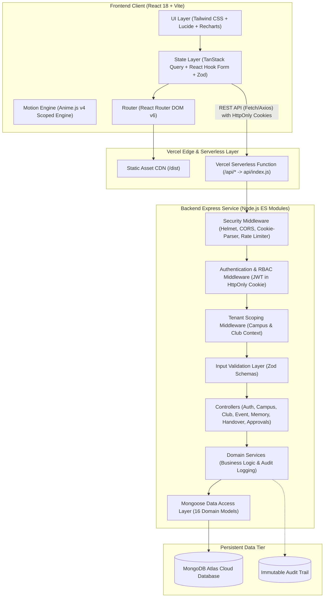
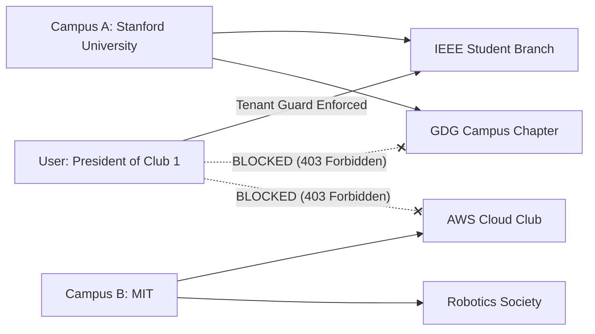

# ClubRelay — System Architecture & Technical Design

## 1. High-Level Architecture Overview

ClubRelay follows a **Multi-Tenant Serverless-Compatible Monolith Architecture** utilizing ES Modules JavaScript on both frontend and backend.



---

## 2. Multi-Tenant Scoping & Isolation Model

Multi-tenancy is enforced on two levels:
1. **Primary Tenant Boundary (Campus):**  
   Every user, club, academic term, and record strictly belongs to a specific `campusId`. A Campus Admin or Faculty Coordinator can only access data belonging to their campus.
2. **Secondary Tenant Boundary (Club/Organization):**  
   Inside a campus, club-level entities (`Event`, `EventTask`, `KnowledgeItem`, `Contact`, `Decision`, `Handover`) are strictly tagged with `clubId`.  
   - Club Presidents, Club Secretaries, and Core Members have read/write permissions strictly scoped to their assigned club.
   - Cross-club data access is blocked at the backend controller/query layer (`where: { campusId: req.campusId, clubId: req.clubId }`).



---

## 3. Serverless Express Connection Lifecycle

When deployed to Vercel, traditional long-running Node.js process state must be safely adapted:
1. **Mongoose Connection Caching:**  
   MongoDB connections are cached across warm Lambda invocations in a singleton promise:
   ```javascript
   let cached = global.mongoose;
   if (!cached) cached = global.mongoose = { conn: null, promise: null };
   ```
2. **Stateless Authentication:**  
   JSON Web Tokens (JWT) stored in `HttpOnly`, `SameSite=Lax`, `Secure` cookies. Revocation lists and membership lookups are verified against the database.
3. **Stateless Uploads:**  
   Upload metadata and external storage URLs are persisted in the database; files are never written to the local serverless filesystem.

---

## 4. Role-Based Access Control (RBAC) Matrix

| Action / Capability | Campus Admin | Faculty Coord | Club President | Club Secretary | Core Member | General Member |
| :--- | :---: | :---: | :---: | :---: | :---: | :---: |
| Manage Campus Settings & Terms | ✅ | ❌ | ❌ | ❌ | ❌ | ❌ |
| Create & Register New Club | ✅ | ❌ | ❌ | ❌ | ❌ | ❌ |
| Review & Approve Event Proposals | ❌ | ✅ | ❌ | ❌ | ❌ | ❌ |
| View Campus-Wide Audit Log | ✅ | ✅ | ❌ | ❌ | ❌ | ❌ |
| Create Event / Propose to Faculty | ❌ | ❌ | ✅ | ✅ | ❌ | ❌ |
| Manage Event Tasks & Assignees | ❌ | ❌ | ✅ | ✅ | ✅ | ❌ |
| Initiate Leadership Handover | ❌ | ❌ | ✅ | ❌ | ❌ | ❌ |
| Complete & Sign Handover Sections | ❌ | ❌ | ✅ | ✅ | ❌ | ❌ |
| Add/Edit SOPs & Knowledge Items | ❌ | ❌ | ✅ | ✅ | ✅ | ❌ |
| View Knowledge Base & Directory | ✅ | ✅ | ✅ | ✅ | ✅ | ✅ |
| Generate Annual Reports (PDF/CSV) | ✅ | ✅ | ✅ | ✅ | ❌ | ❌ |

---

## 5. Anime.js Motion Subsystem

Anime.js (v4) is integrated natively with React's lifecycle:
- Motion is strictly scoped using `createScope({ root: rootRef })` inside component containers.
- Effects register animations in `useEffect` and invoke `scope.revert()` in the cleanup return function.
- The motion engine checks `window.matchMedia('(prefers-reduced-motion: reduce)')`. When active, animations are bypassed or set to duration 0.
- Motion principles:
  - **Subtle entrance reveals:** Staggered opacity (`[0, 1]`) and gentle vertical translation (`[8px, 0px]`) for dashboard cards and task lists.
  - **Action confirmations:** Micro-scale bounce (`[1, 0.98, 1]`) on critical actions (handover section sign-off, proposal approval).
  - **Zero layout thrashing:** Only `transform` and `opacity` are animated.
